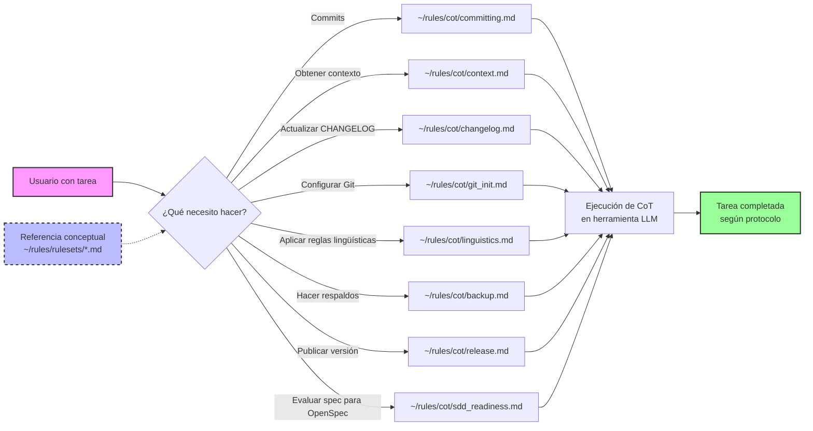
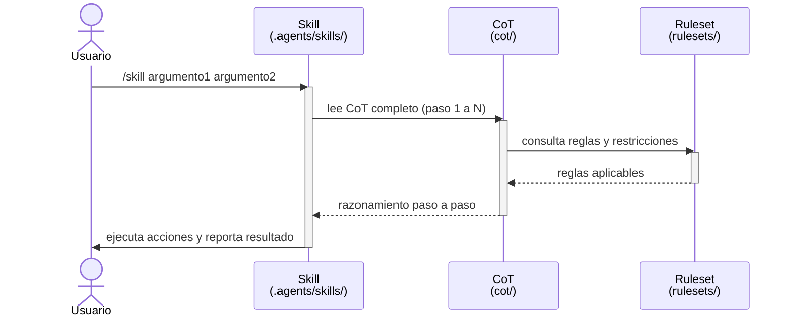

# Reglas técnicas: prompts y CoT para acelerar el contexto de los LLM

*Última modificación: 15 de octubre de 2026, 15:26 (CST)*

[](https://github.com/incognia/rules/actions/workflows/ci.yaml)
[](https://www.gnu.org/licenses/gpl-3.0.html)
[](https://commonmark.org)
[-green.svg)](https://es.wikipedia.org/wiki/Espa%C3%B1ol_mexicano)
[](./cot/)
[](./.agents/skills/)
[](./rulesets/)

## Definiciones rápidas

- *Prompt*: instrucción o contexto que le das al modelo para indicarle qué hacer, con qué tono y bajo qué restricciones.
- CoT (*Chain-of-Thought*): cadena de razonamiento paso a paso que hace explícito cómo se llega a una respuesta, útil para tareas complejas.

Este repositorio contiene las reglas, estándares y filosofía que guían el trabajo técnico y la colaboración en los proyectos de Rodrigo Álvarez. En la práctica diaria se prioriza el uso de los CoT: los documentos describen la lógica de las reglas, pero las herramientas de trabajo cotidianas son los CoT en sí.

## Filosofía principal

Un manifiesto contra tres males endémicos en tecnología latinoamericana:

- **Mercenazgo:** trabajos mediocres sin compromiso real
- **Egoísmo técnico:** acaparar conocimiento para crear dependencia
- **Falta de identidad:** complejos culturales que degradan la calidad

### Contexto académico relacionado

- La idea de usar este repositorio como contexto instruccional para LLM se alinea con la línea de investigación «chain-of-thought prompting», que muestra que proporcionar cadenas de razonamiento mejora el desempeño en tareas complejas.
- Referencia: Jason Wei et al., «Chain-of-Thought Prompting Elicits Reasoning in Large Language Models», arXiv:2201.11903. DOI: [10.48550/arXiv.2201.11903](https://doi.org/10.48550/arXiv.2201.11903) (resumen: [arXiv:2201.11903](https://arxiv.org/abs/2201.11903)).

## Flujo de trabajo diario con CoT (recomendado)

Principio operativo: los documentos de `rulesets/` contienen la lógica y las reglas; sin embargo, las herramientas de trabajo del día a día son los CoT ubicados en `cot/`.

### Configuración inicial (una sola vez)

#### Instalar o actualizar (macOS, Linux y Windows con WSL)

```bash
# 1. Clonar el repositorio (en WSL, dentro de WSL) o actualizarlo si ya existe
git clone git@github.com:incognia/rules.git ~/rules 2>/dev/null || git -C ~/rules pull

# 2. Instalar skills y workflows globales (detecta la plataforma automáticamente)
~/rules/scripts/sync_global.sh

# 3. (Opcional, para contribuir) activar los hooks de commit del repositorio
npm --prefix ~/rules run hooks:install
```

`sync_global.sh` siempre se ejecuta desde un clon local: no se admite ejecutarlo con `curl … | bash`, para que puedas revisar lo que corre antes de ejecutarlo.

**Notas**:

- `sync_global.sh` detecta la plataforma (macOS, Linux, Windows o WSL) y copia a las rutas correctas:
  - *Skills* (`SKILL.md`): `~/.agents/skills/` (en WSL, la carpeta de usuario de Windows); se reflejan completas, así que los archivos borrados dentro de una *skill* también se eliminan, y se quitan las *skills* que el *script* instaló antes y ya no existen en el repositorio. Las reconocen Warp, Cursor, Gemini y otros; GitHub Copilot CLI, Codex y Antigravity CLI (`agy`) las descubren directo en esta carpeta, sin copia ni enlace adicional
  - *Skills* para Claude Code: cada `SKILL.md` instalado se enlaza a `~/.claude/commands/<nombre>.md` para que Claude Code reconozca `/nombre` (sin este enlace, Claude Code ignora los *slash commands*); solo enlaza las *skills* de este repositorio, nunca sobrescribe un comando ajeno y limpia los enlaces colgantes
  - *Workflows* (`*.yaml`) en macOS: `~/.warp/workflows/`
  - *Workflows* en Linux: `$XDG_DATA_HOME/warp-terminal/workflows/`
  - *Workflows* en Windows: `$APPDATA\warp\Warp\data\workflows\`; en WSL no hay una ruta conocida de Warp y se usa `~/.warp/workflows/`
  - Los *workflows* que el *script* instaló antes y ya no existen en el repositorio se eliminan
- `cot/`, `rulesets/` y `templates/` se copian a `~/rules/` solo si el repositorio está clonado en otra ruta; si el clon ya vive en `~/rules/`, no se copia nada
- `scripts/atlassian/` y el `.env` local (credenciales Atlassian, permisos 600) también se copian a `~/rules/` en ese caso; el resto de `scripts/` no se copia y se ejecuta directo desde el repositorio
- El `.env` nunca se versiona: se crea a partir de `.env.example` y guarda credenciales y datos sensibles (sitios de Atlassian, IP e infraestructura de los ambientes, datos de contacto). El repositorio es público, así que los archivos versionados solo llevan marcadores como `<client_ip>` o `{GATEWAY_IP}`
- Para actualizar después de un `git pull`, solo ejecuta: `~/rules/scripts/sync_global.sh`
- `cot/`, `rulesets/` y `templates/` se acceden por ruta canónica, sin enlace simbólico (`~/rules/cot/`, `~/rules/rulesets/`); la excepción es la exportación de *skills* a Claude Code arriba, que sí usa un enlace simbólico

**Invocación de *skills* por herramienta**: la misma *skill* usa el prefijo de la herramienta que la ejecuta; el nombre y los argumentos no cambian.

| Herramienta | De dónde la lee | Invocar | Con argumentos |
|-------------|-----------------|---------|----------------|
| Claude Code | `~/.claude/commands/<nombre>.md` (enlace de `sync_global.sh`) | `/changelogger` | `/linguistics README.md` |
| GitHub Copilot CLI | `~/.agents/skills/<nombre>/` | `/changelogger` | `/linguistics README.md` |
| Codex | `~/.agents/skills/<nombre>/` (y `.agents/skills/` del repositorio) | `$changelogger` | `$linguistics README.md` |
| Antigravity CLI (`agy`) | `~/.agents/skills/<nombre>/` (y `.agents/skills/` del repositorio) | `/changelogger` | `/linguistics README.md` |

En este README los ejemplos usan `/nombre`; en Codex cambia el prefijo por `$`. Con `/skills` dentro de Codex ves las que descubrió.

### Uso diario



**Ejemplos de invocación**:

- `Aplica ~/rules/cot/committing.md`
- `Aplica ~/rules/cot/context.md`
- `Aplica ~/rules/cot/changelog.md`

**Principio clave**: prioriza siempre los CoT para ejecución; usa los documentos de `rulesets/` como referencia conceptual.

## Documentos incluidos

- **[PHILOSOPHY.md](./PHILOSOPHY.md)** - filosofía principal y manifiesto de desarrollo
- **[AGENTS.md](./AGENTS.md)** - guía para agentes IA que trabajan con este repositorio
- **[CORPORATE.md](./rulesets/CORPORATE.md)** - perfil profesional corporativo
- **[TEACHING.md](./rulesets/TEACHING.md)** - perfil educativo y de divulgación científica
- **[ATTRIBUTION.md](./rulesets/ATTRIBUTION.md)** - reglas de atribución personal
- **[COMMITTING.md](./rulesets/COMMITTING.md)** - reglas para mensajes de *commit*, idioma por contexto y gestión de cambios
- **[RELEASING.md](./rulesets/RELEASING.md)** - reglas de *tags* semánticos y *releases* en GitHub o GitLab
- **[SDD_READINESS.md](./rulesets/SDD_READINESS.md)** - rúbrica de madurez de especificaciones para OpenSpec, con Platform Readiness
- **[CRITICAL_COT_READING.md](./rulesets/CRITICAL_COT_READING.md)** - regla de lectura completa de los CoT
- **[GIT.md](./rulesets/GIT.md)** - configuración inicial de cuentas GitHub y GitLab
- **[LICENSING.md](./rulesets/LICENSING.md)** - reglas de licenciamiento para proyectos
- **[LINGUISTICS.md](./rulesets/LINGUISTICS.md)** - reglas lingüísticas de español mexicano como referente
- **[STYLING.md](./rulesets/STYLING.md)** - reglas de estilo para documentos Markdown (proyectos laborales)
- **[BACKUPS.md](./rulesets/BACKUPS.md)** - políticas de respaldos y operaciones destructivas
- **[GLOSSARY.md](./rulesets/GLOSSARY.md)** - glosario técnico de términos empleados
- **[MAIL.md](./rulesets/MAIL.md)** - reglas de composición de correos HTML para OWA
- **[BMAIL.md](./rulesets/BMAIL.md)** - reglas de redacción de correo empresarial en inglés
- **[KUBE.md](./rulesets/KUBE.md)** - reglas de análisis de clústeres Kubernetes
- **[KUBETBS.md](./rulesets/KUBETBS.md)** - reglas de *troubleshooting* de microservicios en Kubernetes
- **[LATEX.md](./rulesets/LATEX.md)** - reglas de generación de documentos LaTeX con XeLaTeX
- **[VAULT.md](./rulesets/VAULT.md)** - reglas de operación con HashiCorp Vault CLI
- **[docs/MAIL.md](./docs/MAIL.md)** - envío de correo desde CLI (modos owa, mac, graph y token; configuración de Graph API y ciclo de vida del *token*)
- **[docs/SYNC.md](./docs/SYNC.md)** - mecanismo de sincronización global de `sync_global.sh`
- **[CHANGELOG.md](./CHANGELOG.md)** - historial de cambios del proyecto

## Especialización técnica

Ingeniería DevOps con enfoque en Kubernetes nativo sobre Proxmox VE *bare-metal*, GitOps, observabilidad y mallas de servicios. El perfil técnico completo se mantiene en un solo lugar: [PHILOSOPHY.md](./PHILOSOPHY.md#11-especialización-técnica).

## Flujo de decisión para aplicación de reglas

La mayoría de las reglas en este repositorio tienen una **dualidad de contextos** (personal vs laboral). El flujo de decisión para determinar qué reglas aplicar es el siguiente:

### 1. Identificación del contexto del proyecto

- **Contexto laboral**: proyectos desarrollados para o bajo contrato con **Kabat One**
- **Contexto personal**: proyectos independientes, experimentales o de desarrollo personal

### 2. Aplicación de reglas por contexto

| Aspecto | Personal (`@incognia`) | Laboral (`@incogniadev`) |
|---------|------------------------|---------------------------|
| **Licenciamiento** | GPLv3 (copyleft) | MIT (permisiva) |
| **Autoría** | Rodrigo Álvarez (@incognia) | Rodrigo Álvarez (@incogniadev) |
| **Correo** | [incognia@gmail.com](mailto:incognia@gmail.com) | [ralvarez@kabatone.com](mailto:ralvarez@kabatone.com) |
| **Llave SSH (repositorios)** | ~/.ssh/incognia | ~/.ssh/kone |
| **Llave SSH (servidores)** | ~/.ssh/faraday | ~/.ssh/cad |
| **Estilo de documentos** | No definido aún | [STYLING.md](./rulesets/STYLING.md) aplicable |
| **Idioma documentación** | Español mexicano | Español mexicano |
| **Idioma de código, comentarios y *commits*** | Inglés internacional (UK) | Inglés internacional (UK) |
| **Idioma CHANGELOG y *releases*** | Idioma principal del repositorio | Idioma principal del repositorio |
| **Idioma en Confluence** | Inglés internacional (UK) | Inglés internacional (UK) |

Esta es la clasificación canónica de los *rulesets*; PHILOSOPHY.md la enlaza en vez de repetirla.

### 3. Reglas universales (aplican a ambos contextos)

- **PHILOSOPHY.md**: principios generales de trabajo
- **LINGUISTICS.md**: español mexicano como estándar cultural
- **COMMITTING.md**: Conventional *Commits* en inglés internacional (UK) e idioma por contexto
- **RELEASING.md**: *tags* `vX.Y.Z` y *releases* no interactivas
- **GIT.md**: configuración inicial de repositorios
- **BACKUPS.md**: políticas de respaldos y operaciones destructivas
- **GLOSSARY.md**: términos técnicos estandarizados
- **CRITICAL_COT_READING.md**: lectura completa de los CoT
- **VAULT.md**: operación con HashiCorp Vault CLI

### 4. Reglas de uso dual (diferentes aplicaciones según contexto)

- **LICENSING.md**: define qué licencia usar según el contexto (personal: GPLv3, laboral: MIT)
- **CORPORATE.md**: perfil profesional adaptado a cada entorno
- **TEACHING.md**: perfil educativo y de divulgación científica

### 5. Reglas de uso exclusivamente personal

- **ATTRIBUTION.md**: atribución personal en documentos o *scripts* individuales

### 6. Reglas de uso exclusivamente laboral (Kabat One)

- **STYLING.md**: reglas de estilo para documentos Markdown corporativos
- **LATEX.md**: documentos LaTeX con la marca Kabat One
- **MAIL.md**: correos HTML compatibles con OWA
- **BMAIL.md**: correo empresarial en inglés
- **KUBE.md** y **KUBETBS.md**: análisis de clústeres y diagnóstico de microservicios
- **SDD_READINESS.md**: madurez de especificaciones de Confluence para OpenSpec

## Arquitectura: *skills*, CoTs y *rulesets*



- **Skill** (interfaz) — punto de entrada descubierto automáticamente; define *qué hacer* y recibe argumentos
- **CoT** (*middleware*) — cadena de razonamiento paso a paso; define *cómo razonar* para completar la tarea
- **Ruleset** (*backend*) — reglas y restricciones de referencia; define *qué está permitido y qué no*

## Estructura del repositorio

- **rulesets/** — reglas y documentación de referencia (LINGUISTICS.md, COMMITTING.md, etc.)
- **cot/** — cadenas de razonamiento (CoT) para ejecución diaria
- **templates/** — plantillas reutilizables
- **scripts/** — *scripts* de automatización y respaldos
- **.agents/skills/** — *skills* descubribles por agentes IA (ejemplos con `/` de Claude Code, Copilot y Antigravity; en Codex usa `$`):
  - `/commit` — flujo completo de *commits* atómicos con CHANGELOG obligatorio, mensaje en inglés internacional (UK) y atribución `Co-Authored-By` detectada de la sesión activa con `scripts/commit_trailer.py` (Claude Code, Codex, Copilot CLI y Antigravity CLI `agy`)
  - `/changelogger` — mantenimiento de CHANGELOG.md con fechas CST, en el idioma principal del repositorio
  - `/release vX.Y.Z` — publicar *tag* y *release* en GitHub o GitLab con notas derivadas del CHANGELOG
  - `/linguistics <archivo>` — aplicar reglas de español mexicano
  - `/context` — detección rápida de contexto de proyecto
  - `/backup` — respaldo con nomenclatura estándar
  - `/licensing` — licenciamiento automático (GPLv3 vs MIT)
  - `/git-init <personal|laboral> <llave> <url> <rama>` — inicializar repo con SSH (mismos argumentos que `scripts/git-init-context.sh`)
  - `/ssh-import <faraday|cad>` — importar llave SSH desde GitHub a un servidor
  - `/mail <owa|mac|graph> <delivery|generic> <asunto>` o `/mail token` — componer y enviar correo HTML compatible con OWA, o revisar el *token* de Graph
  - `/bmail <plantilla> <asunto>` — redactar correo empresarial en inglés con plantillas
  - `/styling <hedgedoc|gitlab|github> [mit|gpl] <archivo>` — aplicar estilo Kabat One a un documento Markdown
  - `/kube <llave> <usuario> <ip> <namespace>` — analizar el estado de un clúster Kubernetes vía SSH
  - `/kubetbs <llave> <usuario> <ip> <namespace> <servicio>` — diagnosticar un microservicio en Kubernetes
  - `/aws-naming <directorio|archivo>` — normalizar nombres de archivos para S3 y CloudFront
  - `/sdd-readiness <enlace a Confluence>` — evaluar si una especificación está lista para ejecutarse con OpenSpec, incluida Platform Readiness
- **.warp/workflows/** — comandos parametrizados YAML (`Ctrl+Shift+R` en Warp):
  - `backup_file` — respaldar archivo o carpeta
  - `lint_markdown` — ejecutar *markdownlint*
  - `commit_flow` — alternativa manual a `/changelogger` y `/commit`: *commit* y *push* con mensaje de Commits Convencionales (tipo, ámbito opcional y descripción), que aborta si `CHANGELOG.md` no tiene cambios
  - `cst_date` — obtener fecha/hora en CST

## Herramientas y scripts

- Sincronización: scripts/sync_global.sh (instala *skills* y *workflows* globales, multiplataforma)
- Git (tras `git init`): `scripts/git-init-context.sh <personal|laboral> <llave> <url_remota> <rama>` (no interactivo)
- Atribución de *commits*: `scripts/commit_trailer.py` (imprime el *trailer* `Co-Authored-By` del modelo de la sesión activa en Claude Code, Codex, Copilot CLI o Antigravity CLI `agy`; `--tool` fuerza la herramienta)
- Fecha CST: scripts/cst_date.sh
- Correo vía Graph API: scripts/graph_auth.py (autenticación y caché de *token*)
- Confluence: scripts/atlassian/ (`confluence-management.sh` para páginas, adjuntos, comentarios al pie y respuestas en ADF, y `find-marked` para ubicar un hilo marcado; `adf_lib.py` para construir y leer ADF; credenciales en `.env`)
- Respaldos:
  - scripts/quick_bkp.sh (copia rápida en el mismo directorio: `archivo_YYYY-MM-DD.ext.bkp`)
  - scripts/backup_file.sh (archivos/directorios, .tar.zst, *checksum* >=100 MB, log CST)
  - scripts/backup_rsync_snapshot.sh (incrementales diarios con rsync --link-dest)
  - scripts/verify_backups.sh (verificación masiva de .sha256)

## Cómo usar CoT rápidamente

- Todos los CoT: carpeta [cot/](./cot/) (24 archivos)
- Lingüística: [cot/linguistics.md](./cot/linguistics.md) + [LINGUISTICS.md](./rulesets/LINGUISTICS.md)
- *Commits*: [cot/committing.md](./cot/committing.md) + [COMMITTING.md](./rulesets/COMMITTING.md)
- Contexto de proyecto: [cot/context.md](./cot/context.md)
- CHANGELOG: [cot/changelog.md](./cot/changelog.md)
- *Releases*: [cot/release.md](./cot/release.md) + [RELEASING.md](./rulesets/RELEASING.md)
- Madurez de especificaciones (OpenSpec): [cot/sdd_readiness.md](./cot/sdd_readiness.md) + [SDD_READINESS.md](./rulesets/SDD_READINESS.md)
- Correos HTML: [cot/mail.md](./cot/mail.md) + [MAIL.md](./rulesets/MAIL.md)

## Convenciones de fechas/horas

- Formato: 24 horas, zona «CST (Ciudad de México)».
- **CRÍTICO**: No rotular «CST» a horas UTC sin cálculo; CST = UTC - 6 horas.
- **Verificación obligatoria**: usar `TZ=America/Mexico_City date` para obtener tiempo real.
- Zona a usar en *scripts*: TZ=America/Mexico_City.
- CHANGELOG.md: solo fecha (YYYY-MM-DD), sin hora.

Más detalles: ver [LINGUISTICS.md – Fechas y horas (CST Ciudad de México)](./rulesets/LINGUISTICS.md#fechas-y-horas-cst-ciudad-de-méxico).

### Ejemplos de comandos

```bash
# Fecha (CST) para CHANGELOG.md
TZ=America/Mexico_City date +"%Y-%m-%d"

# Fecha y hora (CST) legible
TZ=America/Mexico_City date '+%F %H:%M %Z'
LC_TIME=es_MX.UTF-8 TZ=America/Mexico_City date '+%d de %B de %Y, %H:%M (%Z)'

# Verificar cálculo correcto comparando UTC vs CST
echo "UTC: $(date -u '+%H:%M')" && echo "CST: $(TZ=America/Mexico_City date '+%H:%M')"
```

Ejemplos de conversión UTC → CST:

- UTC 14:30 → CST 08:30 (14 - 6 = 8)
- UTC 03:15 → CST 21:15 (día anterior, 03 - 6 = -3, entonces 24 - 3 = 21)

## Uso

Estos documentos sirven como referencia para mantener consistencia en:

- metodologías de trabajo técnico
- estándares de infraestructura y documentación
- políticas de licenciamiento
- convenciones lingüísticas y culturales
- aplicación correcta de reglas según el contexto del proyecto

<!-- licence:start -->

---

*Este proyecto fue elaborado por Rodrigo Álvarez (@incognia) y se distribuye bajo la licencia GPLv3. Para más detalles, consulta el archivo LICENSE. Los logotipos de Kabat One y las imágenes de firma de `templates/mail/assets/` quedan excluidos de la GPLv3: consulta el archivo NOTICE.*

*Copyright © 2026, Rodrigo Ernesto Álvarez Aguilera. Este es software libre bajo los términos de la GNU General Public License v3.*

<!-- licence:end -->
