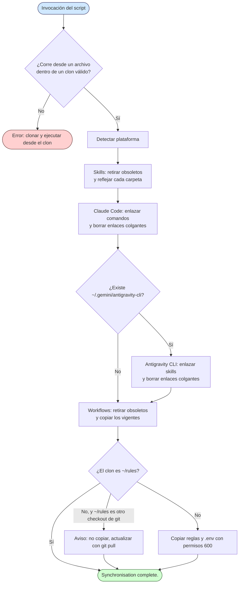
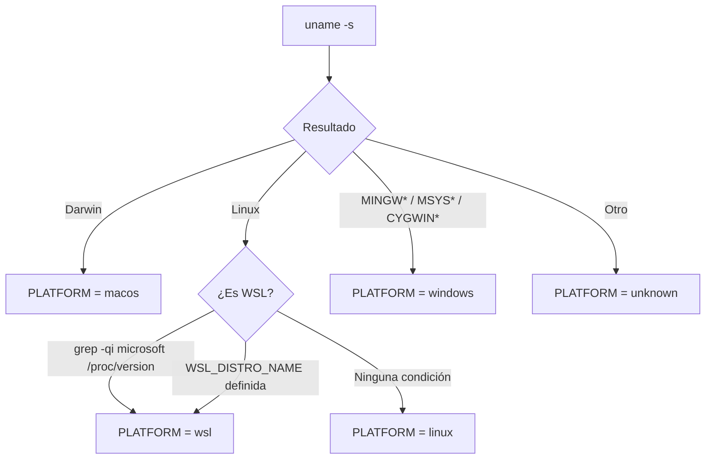
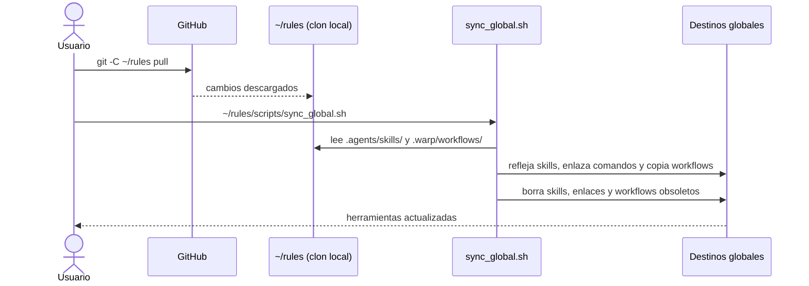

# Mecanismo de sincronización global

*Última modificación: 14 de octubre de 2026, 00:08 (CST)*

Este documento describe cómo funciona `scripts/sync_global.sh`: qué copia, a dónde, qué limpia y por qué cada decisión de diseño existe.

## Propósito

Claude Code, Warp y otros agentes de IA descubren *skills* y *workflows* en rutas fijas del sistema de archivos del usuario. El repositorio `rules` los guarda versionados en `.agents/skills/` y `.warp/workflows/`, pero esas rutas solo sirven dentro del propio repositorio. `sync_global.sh` cierra esa brecha: instala cada artefacto en la ruta global que espera cada herramienta y retira lo que el repositorio ya no contiene.

## Requisito: ejecutar desde un clon

El *script* se ejecuta siempre desde un clon del repositorio. Ubica la raíz a partir de su propia ruta y aborta con un mensaje claro si no corre desde un archivo dentro de un clon válido. Por eso ya no se admite la ejecución remota con `curl … | bash` ni `bash <(curl …)`: en esos casos el *script* no tiene una ruta en disco y no puede encontrar el repositorio.

```bash
# Instalar por primera vez
git clone git@github.com:incognia/rules.git ~/rules
~/rules/scripts/sync_global.sh

# Actualizar
git -C ~/rules pull && ~/rules/scripts/sync_global.sh
```

El *script* corre con `set -Eeuo pipefail`: cualquier paso que falle detiene la sincronización e imprime la línea del error, así que nunca muestra «✓» ni «Synchronisation complete.» después de una falla. Sus mensajes están en inglés internacional (Reino Unido), como el resto del código.

## Qué se sincroniza

| Artefacto | Destino | Forma |
|-----------|---------|-------|
| *Skills* (`.agents/skills/<nombre>/`) | `~/.agents/skills/<nombre>/` (en WSL, el *home* de Windows) | Copia reflejada de cada carpeta, con limpieza |
| Comandos de Claude Code | `~/.claude/commands/<nombre>.md` | Enlace simbólico al `SKILL.md` instalado |
| *Skills* de Antigravity CLI (`agy`) | `~/.gemini/antigravity-cli/skills/<nombre>/` | Enlace simbólico a la carpeta instalada, solo si existe `~/.gemini/antigravity-cli/` |
| *Workflows* (`.warp/workflows/*.yaml`) | Carpeta de *workflows* de Warp según la plataforma | Copia, con limpieza |
| `cot/`, `rulesets/`, `templates/`, `scripts/atlassian/` | `~/rules/` | Copia, solo si el clon no es `~/rules` |
| `.env` (no versionado) | `~/rules/.env` | Copia con permisos 600, solo si el clon no es `~/rules` |

El resto del repositorio (`docs/`, los demás *scripts*, `PHILOSOPHY.md`) no se copia. Las referencias canónicas del tipo `~/rules/rulesets/X.md` o `~/rules/scripts/graph_auth.py` funcionan completas solo si el clon vive en `~/rules`, que es la ubicación recomendada.

## Flujo general de ejecución



## Detección de plataforma

La detección usa `uname -s`, con un caso especial para WSL dentro de la rama `Linux`:



## *Skills*

Cada carpeta de `.agents/skills/` se refleja en la carpeta global de *skills*: con `rsync -a --delete` cuando está disponible y, si no, con una copia completa que reemplaza la carpeta destino. Así se copian también los archivos ocultos y desaparecen los archivos que se borraron dentro de una *skill*.

El *script* lleva la lista de *skills* que instaló en `.rules-managed-skills`, dentro de la carpeta destino. En cada ejecución:

1. Borra las *skills* heredadas que se renombraron o retiraron antes de que existiera esa lista (`changelog` y `cad-access`).
2. Borra las *skills* de la lista anterior que ya no existen en el repositorio.
3. Refleja las *skills* vigentes y reescribe la lista.

Las *skills* que el usuario instaló por su cuenta en la misma carpeta no se tocan.

En WSL el destino es el *home* de Windows, porque ahí las lee Warp. El *script* lo calcula en tiempo de ejecución y aborta si `cmd.exe` no devuelve `%USERPROFILE%`:

```bash
WIN_PROFILE="$(cmd.exe /C "echo %USERPROFILE%" 2>/dev/null | tr -d '\r')"
SKILLS_DST="$(wslpath "$WIN_PROFILE")/.agents/skills"
```

## Comandos de Claude Code

Claude Code reconoce `/nombre` cuando existe `~/.claude/commands/<nombre>.md`. Sin ese enlace ignoraba estos comandos; es el mecanismo validado en la práctica. El *script*:

- Crea un enlace simbólico `~/.claude/commands/<nombre>.md` → `<carpeta de skills>/<nombre>/SKILL.md` solo para las *skills* de este repositorio. El enlace apunta a la copia instalada, no al archivo del repositorio, para conservar el comportamiento validado.
- Nunca sobrescribe un comando ajeno: si ya existe un archivo normal con ese nombre, o un enlace que apunta fuera de la carpeta de *skills*, lo deja intacto y muestra un aviso.
- Borra los enlaces colgantes de `~/.claude/commands/` que apuntan a la carpeta de *skills*, por ejemplo los de una *skill* retirada.

## *Skills* de Antigravity CLI

Antigravity CLI (`agy`) no lee `~/.agents/skills/`: sus *skills* globales viven en `~/.gemini/antigravity-cli/skills/<nombre>/`, y a nivel de repositorio lee `.agents/skills/` (ver la [documentación de Antigravity](https://antigravity.google/docs/skills)). Si existe `~/.gemini/antigravity-cli/`, el *script*:

- Crea un enlace simbólico `~/.gemini/antigravity-cli/skills/<nombre>` → `<carpeta de skills>/<nombre>` para cada *skill* de este repositorio.
- Nunca sobrescribe una *skill* ajena: si ya existe una carpeta normal con ese nombre, o un enlace que apunta fuera de la carpeta de *skills*, la deja intacta y muestra un aviso.
- Borra los enlaces colgantes que apuntan a la carpeta de *skills*.

Si Antigravity CLI no está instalado, omite este paso.

## *Workflows*

Los *workflows* de Warp se copian a una carpeta que depende de la plataforma:

| Plataforma | Destino |
|------------|---------|
| macOS | `~/.warp/workflows/` |
| Linux nativo | `$XDG_DATA_HOME/warp-terminal/workflows/` (predeterminado: `~/.local/share/warp-terminal/workflows/`) |
| Windows nativo (Git Bash, MSYS, Cygwin) | `$APPDATA/warp/Warp/data/workflows/` o, si falta `APPDATA`, `~/.warp/workflows/` |
| WSL y plataformas desconocidas | `~/.warp/workflows/` del *home* de Linux, con un aviso: el *script* no conoce una ruta de Warp para ellas |

Igual que con las *skills*, el *script* lleva la lista de *workflows* que instaló en `.rules-managed-workflows` y borra los que ya no existen en el repositorio. Los *workflows* que el usuario agregó por su cuenta no se tocan.

Los *workflows* usan rutas absolutas (`$HOME/rules/...`), así que funcionan desde cualquier carpeta. `commit_flow.yaml` es el respaldo manual de `/changelogger` y `/commit`: aborta si `CHANGELOG.md` no tiene cambios, toma el tipo, el ámbito y la descripción como texto literal (nunca como código de *shell*), escribe el mensaje en un archivo temporal, hace *commit* con `git commit -F` y después *push*.

## Reglas y `.env`

Cuando el clon no está en `~/rules`, el *script* copia `cot/`, `rulesets/`, `templates/` y `scripts/atlassian/` a `~/rules/`, y también `.env` con `install -m 600`. Esta copia no borra archivos que ya no existen en el repositorio.

Hay dos casos en los que no copia nada:

- **El clon es `~/rules`**: origen y destino son lo mismo.
- **`~/rules` es otro *checkout* de git**: copiar encima lo dejaría con cambios sin confirmar; el *script* avisa y sugiere actualizarlo con `git pull`.

Al final, si no existe `~/rules/.env`, recuerda copiar `.env.example` a `.env` y llenar las credenciales de Atlassian. El *script* nunca imprime el contenido de `.env`.

## Estructura instalada

```text
~/.agents/skills/
├── .rules-managed-skills     ← lista de skills instaladas por el script
├── changelogger/
│   └── SKILL.md
├── commit/
│   └── SKILL.md
└── ...

~/.claude/commands/
├── changelogger.md -> ~/.agents/skills/changelogger/SKILL.md
├── commit.md       -> ~/.agents/skills/commit/SKILL.md
└── ...

~/.gemini/antigravity-cli/skills/   ← solo si Antigravity CLI está instalado
├── changelogger -> ~/.agents/skills/changelogger
├── commit       -> ~/.agents/skills/commit
└── ...

~/.warp/workflows/            ← macOS; ver la tabla de destinos
├── .rules-managed-workflows
├── backup_file.yaml
├── commit_flow.yaml
├── cst_date.yaml
└── lint_markdown.yaml
```

## Flujo de actualización



## Referencias

- *Script* fuente: [`scripts/sync_global.sh`](../scripts/sync_global.sh)
- *Skills* del repositorio: [`.agents/skills/`](../.agents/skills/)
- *Workflows* del repositorio: [`.warp/workflows/`](../.warp/workflows/)
- Plantilla de configuración local: [`.env.example`](../.env.example)
- Configuración inicial: [`README.md`](../README.md), sección «Configuración inicial»
