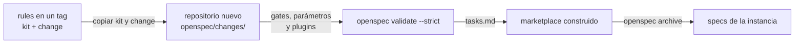

# *Marketplace* de *plugins* para Claude Code: especificación genérica

*Última modificación: 27 de noviembre de 2026, 16:11 (CST)*

Proyecto de OpenSpec que especifica cómo construir **desde cero** un *marketplace* de *plugins* y *skills* de Claude Code para cualquier organización o proyecto. Nace de llevar a *plugins* reutilizables las *skills* personales de este repositorio (`.agents/skills/`, `cot/` y `rulesets/`) y toma como referencia de resultado el *marketplace* `k1`, que es solo un ejemplo de instancia, no un requisito.

## Qué contiene

```text
marketplace/
├── README.md                          # este archivo
├── LICENSE                            # MIT: todo marketplace/, specs y kit
├── kit/                               # kit de arranque copiable (su README.md explica cómo usarlo)
│   ├── skeleton/                      # raíz de un marketplace nuevo con un plugin de ejemplo
│   ├── templates/                     # instance.json y encabezados de CHANGELOG por modo
│   └── ci/                            # CI de ejemplo para GitHub y GitLab
└── openspec/
    ├── config.yaml                    # contexto y reglas del proyecto (idioma, parámetros)
    ├── .markdownlint.yaml             # hereda el lint del repositorio y admite el formato de OpenSpec
    ├── specs/                         # specs principales: la versión canónica y genérica
    │   ├── marketplace-repository/
    │   ├── cross-cutting-rules/
    │   ├── plugin-git/
    │   ├── plugin-ai/
    │   ├── plugin-sdd/
    │   ├── plugin-llm/
    │   ├── plugin-security/
    │   └── plugin-provision/
    └── changes/
        ├── bootstrap-skill-marketplace/   # plan para construir una instancia nueva
        │   ├── proposal.md                # por qué y qué cambia
        │   ├── design.md                  # decisiones, parámetros y origen de cada skill
        │   ├── tasks.md                   # tareas por plugin, en orden de construcción
        │   └── specs/<capacidad>/spec.md  # deltas ADDED, una por capacidad
        └── archive/
```

Las *specs*, el *proposal*, el *design* y las *tasks* están en inglés internacional (UK), como el código y los *commits*; este README sigue la regla del repositorio y va en español mexicano.

**Licencia:** todo `marketplace/`, *specs* y kit, se distribuye bajo la licencia MIT ([LICENSE](LICENSE)), no bajo la GPLv3 del resto de este repositorio, como declara el [NOTICE](../NOTICE) de la raíz. Así cualquier organización, también una corporativa que licencia su trabajo bajo MIT, puede copiarlo como base de su propio *marketplace* sin heredar el *copyleft*.

## Capacidades

Una capacidad por *plugin* y dos compartidas por todos:

| Capacidad | Qué cubre | Requisitos |
|-----------|-----------|-----------:|
| `marketplace-repository` | Estructura del repositorio y del catálogo (`marketplace.json`), manifiesto de cada *plugin*, versionado semántico por *plugin*, validación con `claude plugin validate`, instalación por SSH, actualizaciones, revisión por equipo, página de catálogo opcional y los *gates* de tipo de proyecto y de formato | 23 |
| `cross-cutting-rules` | Python con parches de seguridad vigentes, secretos que nunca llegan al repositorio, las salidas ni la conversación, idioma de la conversación según el perfil, fechas para personas según el formato y marcas de tiempo de máquina en UTC, documentación multilingüe sincronizada, comandos no interactivos, confirmación antes de publicar o crear, firma del contenido saliente desde el perfil y llaves SSH ed25519 (las de otro algoritmo se recomienda cambiarlas, sin bloquear) | 20 |
| `plugin-git` | Perfil e identidad (`/git:init`, con datos de la compañía en modo corporativo y una llave válida por forja de cada repositorio objetivo, generada si hace falta), CHANGELOG en UTC (`/git:changelog`) y en hora local (cadena POSIX) con el idioma del repositorio (`/git:changelogger`), elegidos por el *gate* de formato, *commits* atómicos con su *gate* (`/git:commit`), *merge requests* y *pull requests* (`/git:mr`), *releases* (`/git:release`) y licencia (`/git:license`: una fija en modo corporativo, a elegir por repositorio en modo personal), en GitLab y GitHub | 35 |
| `plugin-ai` | `AGENTS.md` como única fuente de instrucciones y un `CLAUDE.md` de texto que lo importa (`/ai:init`) | 6 |
| `plugin-sdd` | Evaluación de una especificación de la wiki para OpenSpec, publicada como comentario solo tras confirmar (`/sdd:readiness`) | 6 |
| `plugin-llm` | Bifurcar sesiones de agentes de código a otra máquina por SSH (`/llm:fork-session`) | 8 |
| `plugin-security` | Escaneos de solo lectura (local, por SSH y en CI) con un contrato común `summary.json`, canon de seguridad, impacto de CVE y reportes | 20 |
| `plugin-provision` | Escaneo de capacidad, formulario validado, canon de nombres, secretos por la entrada estándar y plan confirmado antes de crear | 12 |

`git` y `ai` van siempre; `sdd`, `llm`, `security` y `provision` son opcionales y cada instancia elige cuáles incluye.

## *Gates* de la instancia

Antes de construir cualquier *plugin*, la instancia pasa dos *gates*; sin esas decisiones no avanza ninguna tarea.

### Tipo de proyecto: corporativo o personal

`{PROJECT_MODE}` decide cuántos datos lleva cada perfil y a nombre de quién va todo:

| | `corporate` | `personal` |
|---|---|---|
| `{ORG}` | La compañía | La persona |
| Perfil de `/git:init` | Nombre, usuario de la forja, correo corporativo, llave SSH, idioma y `{COMPANY_FIELDS}`: equipo, rol, puesto y firma de correo | Nombre, usuario de la forja, correo, llave SSH e idioma |
| Correo de los *commits* | Solo `{EMAIL_DOMAINS}`; se rechazan los personales | Cualquiera que sea de la persona |
| Licencia | La de la compañía (p. ej. MIT) a su nombre legal | La de la persona (p. ej. GPLv3) a su nombre |
| Firma en comentarios, reportes y correos | Nombre, puesto, rol, compañía y firma de correo | Solo el nombre |
| Revisión | Equipos `{TEAMS}`, revisión cruzada y `CODEOWNERS` | Un solo dueño, sin reglas de equipo |

El nombre y la razón social de la compañía son parámetros de la instancia: nadie los teclea. Cada usuario solo agrega una vez su equipo, rol, puesto y firma.

### Formato: regional o multinacional

`{FORMAT_MODE}` decide las fechas y el idioma de los CHANGELOG:

| | `multinational` | `regional` (por ejemplo, México) |
|---|---|---|
| Cuándo | Equipos en varias zonas horarias (recomendado) | Toda la organización en una región |
| Fechas del CHANGELOG | UTC | `{LOCAL_TZ}`, p. ej. `CST6` |
| Idioma del CHANGELOG y de las notas de *release* | inglés UK | `{REGION_LANGUAGE}` (español mexicano) |
| *Skill* predeterminada | `/git:changelog` | `/git:changelogger` |
| *Commits* y títulos de *merge requests* | inglés UK | inglés UK |
| Comentarios en la wiki | inglés UK | inglés UK |
| Marcas de tiempo de máquina (`summary.json`, cachés) | UTC, ISO 8601 | UTC, ISO 8601 |

Los *commits* van **siempre** en inglés internacional (UK), sin importar el idioma del CHANGELOG, del README o del `AGENTS.md`; por eso su idioma no es un parámetro.

El modo solo decide el formato de los CHANGELOG **nuevos**: uno existente conserva la convención que declara su encabezado, y los dos formatos nunca se mezclan en un archivo. `{LOCAL_TZ}` se escribe como cadena POSIX completa, nunca como nombre IANA (`America/Mexico_City`): Git Bash en Windows no trae la base de zonas horarias y de 18:00 a 23:59 fecharía la entrada al día siguiente, como advierte `rulesets/LINGUISTICS.md`. Una región sin horario de verano usa un desfase fijo (`CST6` para la Ciudad de México); una con horario de verano incluye sus reglas (Israel: `IST-2IDT,M3.4.4/26,M10.5.0`), porque un desfase fijo daría la hora mal la mitad del año. El detalle está en la decisión D12 de [design.md](openspec/changes/bootstrap-skill-marketplace/design.md#d12-format-gate-regional-or-multinational).

## Parámetros

Todo valor propio de una organización aparece en las *specs* como un parámetro entre llaves, por ejemplo `{MARKETPLACE}`, `{GIT_HOST}`, `{EMAIL_DOMAINS}`, `{DOC_TRANSLATIONS}`, `{LOCAL_TZ}`, `{CONFIG_DIR}` o `{ENV_PREFIX}`. La tabla completa, con el significado de cada uno y el valor de la instancia `k1` como ejemplo, está en [design.md](openspec/changes/bootstrap-skill-marketplace/design.md#parameters).

Este repositorio es público: ni las *specs* ni el ejemplo llevan direcciones internas, nombres de máquinas, rutas de secretos ni proyectos internos de ninguna organización.

## Cómo replicarlo en otro proyecto



1. Elige un *tag* del repositorio público <https://github.com/incognia/rules> (será `{ORIGIN_REF}` en tu `design.md`) y clónalo aparte:

   ```bash
   git clone --depth 1 --branch <tag> https://github.com/incognia/rules.git ../rules-origin
   ```

2. En el repositorio nuevo, copia el kit de arranque (MIT, como todo `marketplace/`; los detalles están en `marketplace/kit/README.md`). No se copia `kit/` entero: solo `skeleton/` va tal cual a la raíz, y `templates/` y `ci/` se toman pieza por pieza:
   - `kit/skeleton/` es la raíz del *marketplace*: `.claude-plugin/marketplace.json`, un *plugin* de ejemplo (la *skill* `hello` en línea y `report` con *fork*, con `scripts/` y `references/`), `scripts/python_check.py` con sus pruebas, `AGENTS.md`, `CLAUDE.md`, `CONTRIBUTING.md`, `RELEASING.md`, `README.md` y `.gitignore`;
   - de `kit/templates/`, el `instance.*.json` del modo de proyecto (como `scripts/instance.json` del *plugin* `git`) y el `CHANGELOG.*.md` del modo de formato;
   - de `kit/ci/`, el CI de tu forja.

   Después inicializa OpenSpec y copia el *change*:

   ```bash
   cp -R ../rules-origin/marketplace/kit/skeleton/. .
   ```

   ```bash
   openspec init --tools none .
   ```

   ```bash
   cp -R ../rules-origin/marketplace/openspec/changes/bootstrap-skill-marketplace openspec/changes/
   ```

3. Pasa los dos *gates* (`{PROJECT_MODE}`; `{FORMAT_MODE}` y, si es `regional`, `{LOCAL_TZ}` y `{REGION_LANGUAGE}`), llena el resto de la tabla de parámetros del `design.md` copiado y define `{PLUGINS}`; borra las *specs* delta y las tareas de los *plugins* opcionales que no vayas a incluir.
4. Valida el *change* instanciado:

   ```bash
   openspec validate bootstrap-skill-marketplace --strict
   ```

5. Trabaja `tasks.md` en orden (parámetros, repositorio, reglas compartidas, `git`, los demás *plugins*, CI y verificación).
6. Al terminar, archiva el *change*: las *specs* principales de la instancia son el resultado.

   ```bash
   openspec archive bootstrap-skill-marketplace --yes
   ```

## Mantenimiento en este repositorio

Aquí el *change* no se archiva: es la plantilla que se copia. Las *specs* principales son exactamente lo que produce archivarlo, así que un requisito se edita, con la misma edición, en los dos lugares y en el mismo *commit*; nunca se regeneran las *specs* sobrescribiéndolas.

Una sola verificación cubre todo: `openspec validate --all --strict`, que las *specs* principales sigan iguales al *change* archivado en una copia temporal, y las pruebas del kit. También corre en el CI de este repositorio, con la versión de OpenSpec fijada en `package.json`:

```bash
bash scripts/check-marketplace.sh
```

OpenSpec escribe requisitos y escenarios sin línea en blanco después del encabezado, así que `openspec/.markdownlint.yaml` hereda la configuración del repositorio y solo desactiva MD022 y MD032 en esa carpeta.

## Referencias

- Origen: las *skills* `git-init`, `changelogger`, `commit`, `mr`, `release`, `licensing` y `sdd-readiness` de [.agents/skills/](../.agents/skills/), con sus CoT en [cot/](../cot/) y sus reglas en [rulesets/](../rulesets/) (`COMMITTING.md`, `LINGUISTICS.md`, `LICENSING.md`, `RELEASING.md`, `SDD_READINESS.md`). La relación de cada *skill* con su origen está en [design.md](openspec/changes/bootstrap-skill-marketplace/design.md#origin-of-each-skill).
- OpenSpec: <https://github.com/Fission-AI/OpenSpec>.
