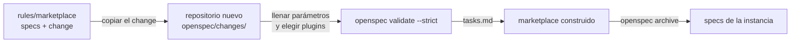

# *Marketplace* de *plugins* para Claude Code: especificación genérica

*Última modificación: 27 de noviembre de 2026, 13:43 (CST)*

Proyecto de OpenSpec que especifica cómo construir **desde cero** un *marketplace* de *plugins* y *skills* de Claude Code para cualquier organización o proyecto. Nace de llevar a *plugins* reutilizables las *skills* personales de este repositorio (`.agents/skills/`, `cot/` y `rulesets/`) y toma como referencia de resultado el *marketplace* `k1`, que es solo un ejemplo de instancia, no un requisito.

## Qué contiene

```text
marketplace/
├── README.md                          # este archivo
└── openspec/
    ├── config.yaml                    # contexto y reglas del proyecto (idioma, parámetros)
    ├── .markdownlint.yaml             # hereda el lint del repositorio y admite el formato de OpenSpec
    ├── specs/                         # specs principales: la versión canónica y genérica
    │   ├── marketplace-repository/
    │   ├── cross-cutting-rules/
    │   ├── plugin-git/
    │   ├── plugin-ai/
    │   ├── plugin-sdd/
    │   ├── plugin-llm/
    │   ├── plugin-security/
    │   └── plugin-provision/
    └── changes/
        ├── bootstrap-skill-marketplace/   # plan para construir una instancia nueva
        │   ├── proposal.md                # por qué y qué cambia
        │   ├── design.md                  # decisiones, parámetros y origen de cada skill
        │   ├── tasks.md                   # tareas por plugin, en orden de construcción
        │   └── specs/<capacidad>/spec.md  # deltas ADDED, una por capacidad
        └── archive/
```

Las *specs*, el *proposal*, el *design* y las *tasks* están en inglés internacional (UK), como el código y los *commits*; este README sigue la regla del repositorio y va en español mexicano.

## Capacidades

Una capacidad por *plugin* y dos compartidas por todos:

| Capacidad | Qué cubre | Requisitos |
|-----------|-----------|-----------:|
| `marketplace-repository` | Estructura del repositorio y del catálogo (`marketplace.json`), manifiesto de cada *plugin*, versionado semántico por *plugin*, validación con `claude plugin validate`, instalación por SSH, actualizaciones, revisión por equipo y página de catálogo opcional | 21 |
| `cross-cutting-rules` | Python con parches de seguridad vigentes, secretos que nunca llegan al repositorio, las salidas ni la conversación, idioma de la conversación según el perfil, documentación multilingüe sincronizada, comandos no interactivos y confirmación antes de publicar o crear | 17 |
| `plugin-git` | Perfil e identidad (`/git:init`), CHANGELOG en UTC (`/git:changelog`) y en hora local con el idioma del repositorio (`/git:changelogger`), *commits* atómicos con su *gate* (`/git:commit`), *merge requests* y *pull requests* (`/git:mr`), *releases* (`/git:release`) y licencia (`/git:license`), en GitLab y GitHub | 30 |
| `plugin-ai` | `AGENTS.md` como única fuente de instrucciones y un `CLAUDE.md` de texto que lo importa (`/ai:init`) | 6 |
| `plugin-sdd` | Evaluación de una especificación de la wiki para OpenSpec, publicada como comentario solo tras confirmar (`/sdd:readiness`) | 6 |
| `plugin-llm` | Bifurcar sesiones de agentes de código a otra máquina por SSH (`/llm:fork-session`) | 8 |
| `plugin-security` | Escaneos de solo lectura (local, por SSH y en CI) con un contrato común `summary.json`, canon de seguridad, impacto de CVE y reportes | 20 |
| `plugin-provision` | Escaneo de capacidad, formulario validado, canon de nombres, secretos por la entrada estándar y plan confirmado antes de crear | 12 |

`git` y `ai` van siempre; `sdd`, `llm`, `security` y `provision` son opcionales y cada instancia elige cuáles incluye.

## Parámetros

Todo valor propio de una organización aparece en las *specs* como un parámetro entre llaves, por ejemplo `{MARKETPLACE}`, `{GIT_HOST}`, `{EMAIL_DOMAINS}`, `{DOC_TRANSLATIONS}`, `{LOCAL_TZ}`, `{CONFIG_DIR}` o `{ENV_PREFIX}`. La tabla completa, con el significado de cada uno y el valor de la instancia `k1` como ejemplo, está en [design.md](openspec/changes/bootstrap-skill-marketplace/design.md#parameters).

Este repositorio es público: ni las *specs* ni el ejemplo llevan direcciones internas, nombres de máquinas, rutas de secretos ni proyectos internos de ninguna organización.

## Cómo replicarlo en otro proyecto



1. En el repositorio nuevo, inicializa OpenSpec y copia el *change*:

   ```bash
   openspec init --tools none .
   ```

   ```bash
   cp -R ~/rules/marketplace/openspec/changes/bootstrap-skill-marketplace openspec/changes/
   ```

2. Llena la tabla de parámetros del `design.md` copiado y define `{PLUGINS}`; borra las *specs* delta y las tareas de los *plugins* opcionales que no vayas a incluir.
3. Valida el *change* instanciado:

   ```bash
   openspec validate bootstrap-skill-marketplace --strict
   ```

4. Trabaja `tasks.md` en orden (parámetros, repositorio, reglas compartidas, `git`, los demás *plugins*, CI y verificación).
5. Al terminar, archiva el *change*: las *specs* principales de la instancia son el resultado.

   ```bash
   openspec archive bootstrap-skill-marketplace --yes
   ```

## Mantenimiento en este repositorio

Aquí el *change* no se archiva: es la plantilla que se copia. Las *specs* principales son exactamente lo que produce archivarlo, así que un requisito se edita en los dos lugares en el mismo *commit*. Para comprobar que siguen iguales:

```bash
tmp=$(mktemp -d) && cp -R openspec "$tmp/" && rm -rf "$tmp/openspec/specs/"* && (cd "$tmp" && openspec archive bootstrap-skill-marketplace --yes >/dev/null) && diff -r "$tmp/openspec/specs" openspec/specs && echo "specs sincronizadas"; rm -rf "$tmp"
```

Validación completa, desde `marketplace/`:

```bash
openspec validate --all --strict
```

OpenSpec escribe requisitos y escenarios sin línea en blanco después del encabezado, así que `openspec/.markdownlint.yaml` hereda la configuración del repositorio y solo desactiva MD022 y MD032 en esa carpeta.

## Referencias

- Origen: las *skills* `git-init`, `changelogger`, `commit`, `mr`, `release`, `licensing` y `sdd-readiness` de [.agents/skills/](../.agents/skills/), con sus CoT en [cot/](../cot/) y sus reglas en [rulesets/](../rulesets/) (`COMMITTING.md`, `LINGUISTICS.md`, `LICENSING.md`, `RELEASING.md`, `SDD_READINESS.md`). La relación de cada *skill* con su origen está en [design.md](openspec/changes/bootstrap-skill-marketplace/design.md#origin-of-each-skill).
- OpenSpec: <https://github.com/Fission-AI/OpenSpec>.
