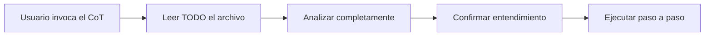

# Regla crítica: lectura completa de los CoT

**Precedencia: máxima.** Esta es la fuente canónica de la regla 1 de [AGENTS.md](../AGENTS.md) («read complete CoT files from line 1 to end»).

## Obligación crítica

Cuando el usuario invoque un CoT (*Chain of Thought*) mediante referencia a `~/rules/cot/*.md`, es **OBLIGATORIO**:

1. **Leer completo** el archivo CoT, desde la línea 1 hasta el final
2. **No comenzar** ninguna acción hasta haber leído todo el contenido
3. **No asumir** ni adivinar instrucciones a partir de las primeras líneas
4. **Analizar con detenimiento** todas las secciones: Razonamiento, Pasos y Conclusión
5. **Identificar contradicciones** aparentes y resolverlas con el contexto completo
6. **Confirmar la comprensión** de todos los pasos antes de proceder

## Errores prohibidos

- Leer solo el inicio del CoT y comenzar a ejecutar
- Saltarse secciones del CoT
- Interpretar parcialmente las instrucciones
- Adivinar el resto del proceso
- Actuar sin confirmar que se entendió todo el flujo

## Flujo obligatorio

## Propósito

Los CoT contienen:

- **Razonamiento crítico** que explica el «porqué»
- **Pasos detallados** que no pueden omitirse
- **Validaciones** específicas requeridas
- **Conclusiones** que confirman el éxito

**Ignorar cualquier parte causa errores críticos.**

## Validación personal

Antes de actuar, pregúntate:

- ¿Leí TODO el CoT?
- ¿Entiendo cada paso y su propósito?
- ¿Hay contradicciones que necesito resolver?
- ¿Confirmé todos los criterios de validación?

---

**Consecuencia del incumplimiento:** error crítico en la ejecución de tareas.

*Elaborado por Rodrigo Álvarez (@incognia)*
